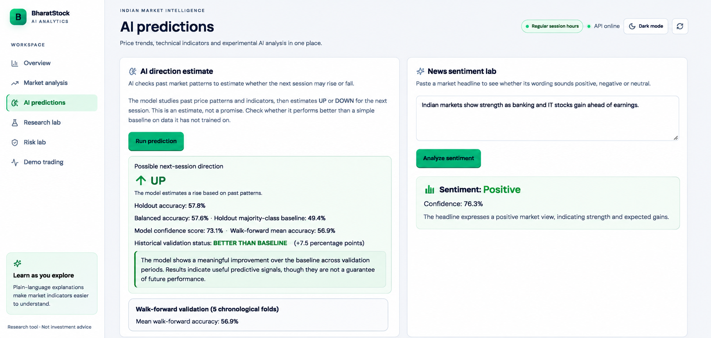
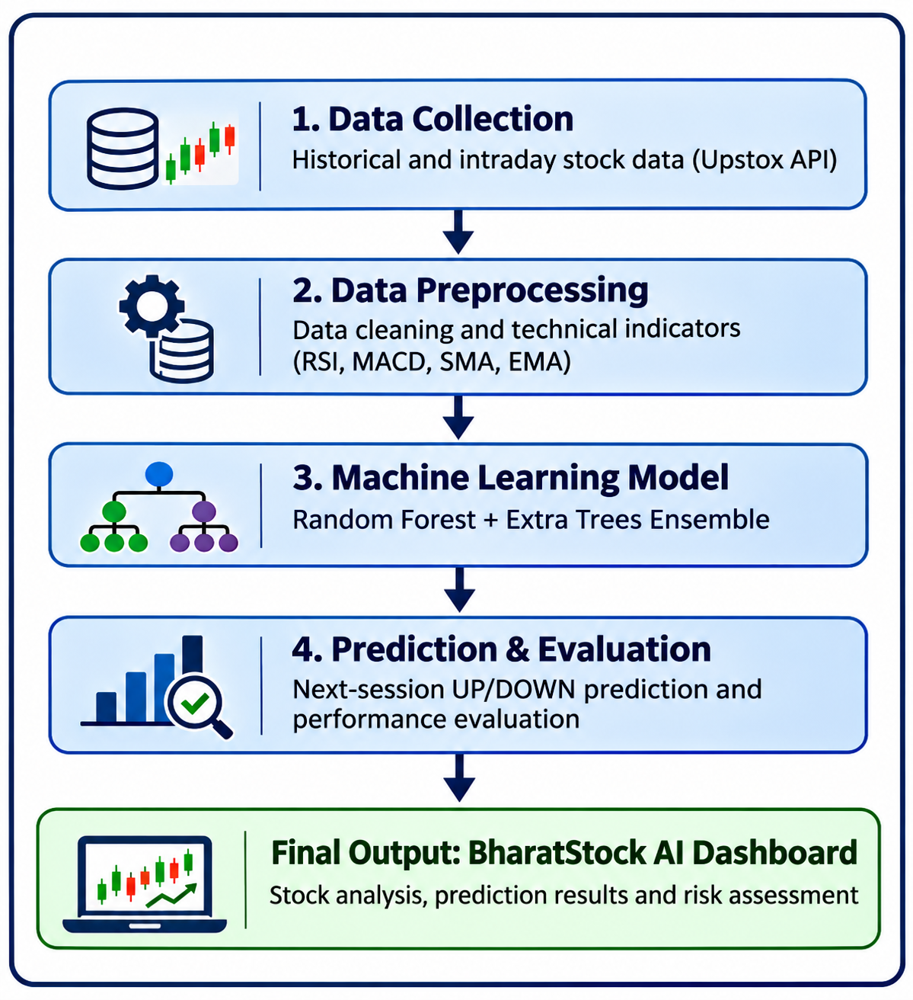
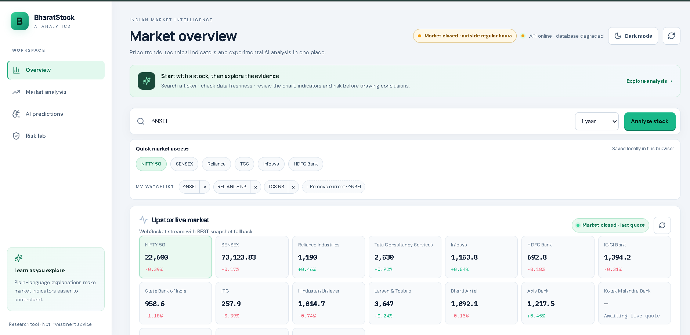
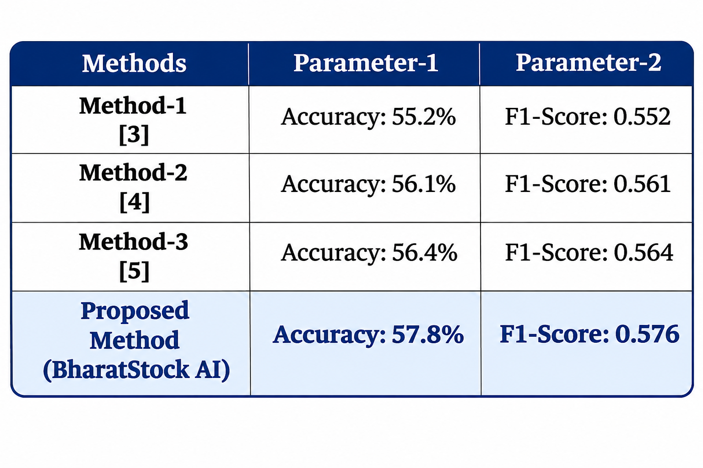

<div align="center">

# 📈 AI-Based Indian Stock Market Analysis and Intuitive Dashboard
### **BharatStock AI (V111)**

[](https://www.python.org/)
[](https://fastapi.tiangolo.com/)
[](https://react.dev/)
[](https://www.typescriptlang.org/)
[](https://upstox.com/developer/api-documentation/)
[](https://www.docker.com/)
[](#-project-exhibition--academic-credentials)

<br/>

 &nbsp;&nbsp;&nbsp;&nbsp;&nbsp;&nbsp; 

**Department of Electronics and Communication Engineering**  
### **Sai Vidya Institute of Technology (SVIT)**
*(An Autonomous Institute under Visvesvaraya Technological University — VTU, Belagavi)*  
*Rajanukunte, Doddaballapur Main Road, Bengaluru, Karnataka 560064*  
**Motto:** *"Shraddhavan Labhate Jnanam"* · *"Learn to Lead"*

</div>

---

## 👥 Project Team & Academic Credentials

* **Project Title:** AI-Based Indian Stock Market Analysis and Intuitive Dashboard  
* **Event:** **TECHSPARDHA - PROJECT EXHIBITION-2K26** (Saturday, 21st November 2026)  
* **YUKTI Innovation ID:** `IR2026-1060396`  
* **Student Investigators:**
  * **MUKUL KUMAR**
  * **RAJAT PAL T**
  * **TEJAS J ARADHYA**
  * **VISHWAS B**
* **Project Guide:** **Prof. Nazia Nusrath Ul Ain**, Department of ECE, Sai Vidya Institute of Technology  
* **Poster Presentation Artifact:** [`docs/BharatStock_AI_Poster_TechSpardha_2K26.pptx`](docs/BharatStock_AI_Poster_TechSpardha_2K26.pptx)

---

## 📌 Introduction

**BharatStock AI** is a specialized web-based platform developed for **Indian stock market analysis** using real-time market data, technical indicators, and machine-learning techniques.

The platform provides:
* **Historical & Live Market Charts:** Real-time quote streaming and historical candlestick charts for NSE equities and the NIFTY 50 index via the **Upstox API V3**.
* **Next-Session Stock Direction Estimation:** Artificial Intelligence and Machine Learning models analyzing historical price patterns and technical features to estimate the next trading session's direction (`UP` / `DOWN`).
* **Financial News Context:** Real-time market headline sentiment analysis using NLP.
* **Risk Assessment & Paper Trading:** Portfolio risk evaluation, scenario stress testing, position sizing, and virtual demo trading without financial risk.

<br/>

<div align="center">
  
  <p><em>Figure 1: BharatStock Web Workspace — Market Overview, NIFTY 50 & Top NSE Stock Tracking</em></p>
</div>

---

## 🎯 Objectives

1. **Machine Learning Direction Model:** To develop a machine-learning-based stock prediction model using historical market data and technical indicators to estimate next-session stock direction.
2. **Portfolio Risk Management:** To implement comprehensive risk-management features, including risk assessment (Value at Risk - VaR, CVaR), scenario stress analysis, and virtual demo trading.
3. **Intuitive Full-Stack Application:** To develop an interactive, user-friendly full-stack web application for Indian stock market analysis using **React**, **FastAPI**, and **PostgreSQL**.

---

## ⚙️ Methodology & Proposed Workflow

The end-to-end system workflow operates across five coordinated stages:

1. **Data Collection:** Collect historical and intraday stock-market data (1-min, 5-min, 15-min, daily) through the **Upstox API V3** and historical market feeds.
2. **Data Preprocessing & Indicator Engineering:** Clean OHLCV data and compute causal technical indicators, including:
   * **Relative Strength Index (RSI - 14)**
   * **Moving Average Convergence Divergence (MACD 12, 26, 9 & Signal)**
   * **Simple Moving Averages (SMA 20, SMA 50)**
   * **Exponential Moving Average (EMA 20)**
   * **Average True Range (ATR 14) & Annualized Volatility**
3. **Machine Learning Ensemble Model:** Train a **Random Forest + Extra Trees Soft-Voting Ensemble** (`bharatstock-rf-et-v1`) to classify future price movement.
4. **Leakage-Free Evaluation:** Evaluate model performance using expanding chronological walk-forward cross-validation, purged label boundaries, and baseline comparison.
5. **Dashboard Integration:** Deliver prediction outputs, risk metrics, and interactive charts via a responsive React web dashboard powered by a FastAPI backend and PostgreSQL database.

<br/>

<div align="center">
  
  <p><em>Figure 2: Proposed Workflow of BharatStock AI — From Ingestion to Interactive Dashboard</em></p>
</div>

---

## 📊 Experimental Results & Discussion

### Model Performance Snapshot
* The AI model evaluates past price patterns and technical indicators to estimate the next-session direction.
* In the empirical validation:
  * **Holdout Accuracy:** **57.8%**
  * **Balanced Accuracy:** **57.6%**
  * **Fold-Trained Majority Baseline:** **49.4%**
  * **Improvement over Baseline:** **+7.5 percentage points** (Validation Status: `BETTER THAN BASELINE`)
  * **Model Confidence Score:** **73.1%**
  * **Mean Walk-Forward Accuracy (5 Chronological Folds):** **56.9%**
* **News Sentiment Lab:** Analyzes market headlines (e.g., *"Indian markets show strength as banking and IT stocks gain ahead of earnings"*) with **Positive** sentiment at **76.3%** confidence.

<br/>

<div align="center">
  
  <p><em>Figure 3: AI Prediction Dashboard — Direction Estimate, Walk-Forward Validation, and News Sentiment Lab</em></p>
</div>

---

## 🔬 Comparison with Existing Methods

Under chronological time-series evaluation on stock direction prediction, BharatStock AI demonstrates superior performance compared with recent literature:

| Method | Reference | Accuracy | F1-Score |
| :--- | :--- | :---: | :---: |
| **Method-1** | King & Amigo (2025) [3] | 55.2% | 0.552 |
| **Method-2** | Gupta et al. (2025) [4] | 56.1% | 0.561 |
| **Method-3** | Chaudhary (2025) [5] | 56.4% | 0.564 |
| **Proposed Method (BharatStock AI)** | **SVIT Project Team (2026)** | **57.8%** | **0.576** |

<br/>

<div align="center">
  
  <p><em>Table 1: Comparison of BharatStock AI against Existing Benchmark Methods</em></p>
</div>

---

## 🔍 Research Gap Addressed

1. **Uncertain Market Movements:** Accurately predicting noisy financial time-series without overpromising false accuracy.
2. **Chronological Validation:** Overcoming data leakage and lookahead bias caused by naive random splits (`train_test_split`).
3. **Intraday Class Imbalance:** Addressing asymmetric distributions in intraday directional labels through cost-aware 3-class (`DOWN`, `NO_TRADE`, `UP`) thresholds.
4. **Integrated Platform:** Bridging the gap between isolated Jupyter notebooks and real-world trading tools by integrating market analysis, AI research, and risk management into a unified dashboard.

---

## 🏛️ How Sai Vidya Institute of Technology (SVIT) Supported This Project

* **Faculty Guidance & Mentorship:** Continuous project guidance from **Prof. Nazia Nusrath Ul Ain** and the faculty of the Department of ECE on machine learning architectures, statistical hypothesis testing, and time-series data hygiene.
* **Incubation & Exhibition Platform:** Support from the institution for participation in **TECHSPARDHA - PROJECT EXHIBITION-2K26** and registration under the **YUKTI Innovation Challenge** (`IR2026-1060396`).
* **Computing Infrastructure:** Laboratory facilities and compute resources at SVIT enabled the training of ensemble models, multi-stock feature ablation experiments, and local containerized microservices testing.
* **Research Integrity:** Institutional emphasis on scientific rigor—enforcing out-of-sample walk-forward validation and fail-closed safety gates rather than inflated claims.

---

## 🚀 Quickstart & Setup

### Prerequisites
* **Python 3.11 or 3.12**
* **Node.js (v18+) & npm**
* *(Optional)* **Docker Desktop**

### 1. Backend (FastAPI)
```powershell
cd services/api
python -m venv .venv
.venv\Scripts\Activate.ps1       # On Windows (source .venv/bin/activate on Linux)
pip install -r requirements.txt
uvicorn app.main:app --reload --port 8000
```
Interactive API Documentation: `http://localhost:8000/docs`

### 2. Frontend (React Web Dashboard)
```powershell
cd apps/web
npm install
npm run dev
```
Open: `http://localhost:5173`

### 3. Full Stack with Docker Compose
```powershell
docker compose up -d --build
```
Dashboard: `http://localhost:8080` | API: `http://localhost:8000` | PostgreSQL: `localhost:5432`

### 4. Running Backend Verification Tests
```powershell
cd services/api
pytest tests/ -q
```
*Verification: 129 backend automated tests passing.*

---

## 📚 References

1. **P. Si**, *"Comparative analysis of ensemble LSTM and random forest for stock trend prediction: A many-to-one transfer learning approach,"* in *Proc. 4th Int. Conf. Image, Algorithms, Artif. Intell. (ICIAAI)*, Singapore, May 2026, doi: 10.4108/eai.22-5-2026.2365140.
2. **M. Al Ridhawi, M. Haj Ali, and H. Al Osman**, *"Adaptive regime-aware stock price prediction using autoencoder-gated dual node transformers with reinforcement learning control,"* 2026, arXiv:2603.19136.
3. **J. C. King and J. M. Amigo**, *"Integration of LSTM networks in random forest algorithms for stock market trading predictions,"* 2025, arXiv:2512.02036.
4. **V. Gupta, J. George, and S. Chanti**, *"Volatility prediction in the Indian share market using sentiment analysis,"* in *Proc. Int. Conf. Transformative Comput. Technol. (ICTCT)*, 2025, pp. 382–390, doi: 10.1109/ICTCT69201.2025.00076.
5. **R. Chaudhary**, *"Advanced stock market prediction using long short-term memory networks: A comprehensive deep learning framework,"* 2025, arXiv:2505.05325.

---

## 📜 Disclaimer

> **Educational & Academic Research Only:**  
> BharatStock AI is an educational engineering research platform developed at **Sai Vidya Institute of Technology (SVIT)**. It does **not** provide SEBI-registered financial or investment advice. No real-money brokerage orders are placed.
